# Lead to owner
[](https://github.com/Maliha-Tasnim/lead-to-owner/actions/workflows/test.yml)
Inbound lead routing for HubSpot, built in n8n. Every new form lead gets an owner (or the right queue) within minutes, with the reason written on the record: duplicates checked, the message read by an AI model, missing fields filled by Clay, a fit and engagement score, nine ordered rules, and a Slack message to the new owner.


*Animated replay of one made-up lead through the workflow. The diagrams and screens in this README are built from the output of the tested code, as simulated views with made-up data. The n8n screenshots further down come from a run in n8n with made-up answers in place of HubSpot, Claude, Clay and Slack. Nothing here comes from a live CRM or Slack workspace.*

## Where this comes from

I designed and ran lead routing for BaseN's HubSpot portal. The original ran on HubSpot workflows, custom code actions (JavaScript) and Clay webhooks, with some steps in Zapier. I can't share BaseN's material, so this is a rebuild of the same design in n8n, written from scratch. Nothing here is copied from BaseN: no code, data, field names or rule values. Every company, person, ID and number in the code and fixtures is made up.

What the original did at BaseN:

- New leads reach an owner in under 5 minutes, down from about a day in a shared queue.
- Dedupe rules cut new duplicates from 40 a month to under 5.
- Clay enrichment and owner routing lifted key-field completeness from 55% to 90%.
- It was part of 23 CRM automations that together save the sales team about 35 hours a month.

Routing time and completeness were measured in HubSpot reports: create date to owner-assigned date, and the fill rate of a named set of key fields. This sample writes the same two measures onto every lead, so the reports work the same way.

## What it does

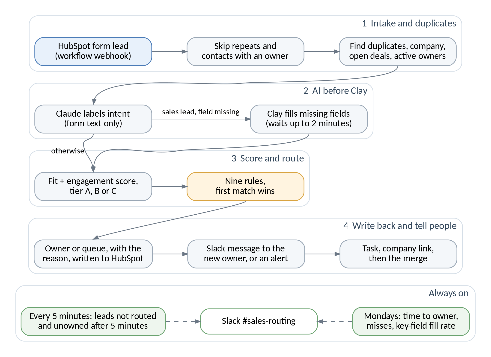

1. **Intake.** A HubSpot workflow sends each new form lead to an n8n webhook. Repeated events, payloads without a contact ID and contacts that already have an owner stop here.
2. **Duplicates and context.** Four HubSpot lookups: possible duplicate contacts plus the lead's own record, the company (by domain, additional domains or name), open deals and active owners. A lead that someone took or routed since HubSpot sent it stops here.
3. **AI before Clay.** Claude labels the intent from the form text only (no name, email or phone). Support requests, job seekers and spam don't spend Clay credits. Sales leads with a missing field go to Clay, and the workflow waits up to 2 minutes for the answer.
4. **Score.** Fit (0 to 60: industry, size, region, seniority) plus engagement (0 to 40: the form just sent, plus pricing views, webinar and email clicks, which lose weight with age). Tier A from 70, tier B from 40.
5. **Route.** Nine rules, first match wins. Every lead gets a rule code and a plain-language reason.
6. **Write back.** HubSpot gets the owner or queue, the reason, the score with its reasons, the AI labels and the completeness score. The new owner gets a Slack message; alerts go to a routing channel; Slack's reply is checked. When needed, a task to reassign a company, a company link, and an exact-match merge, done last.
7. **Always on.** Every 5 minutes a watchdog finds leads that entered the workflow, were never routed and have no owner (a failed run, an API outage), and reports each one once. On Mondays it posts the week's numbers.

## Where the systems connect

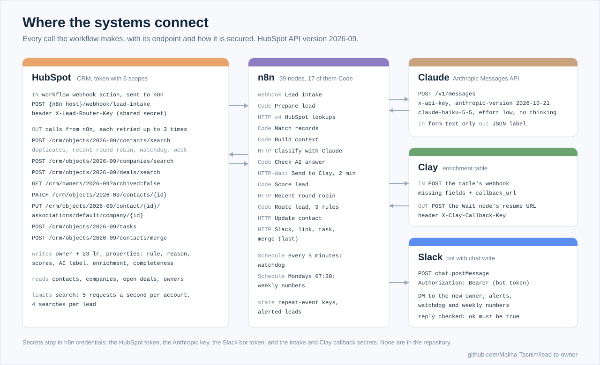

## The data, step by step

One made-up lead (L07, a CTO asking for a demo) from the webhook to Slack, with what each system sends and gets back:

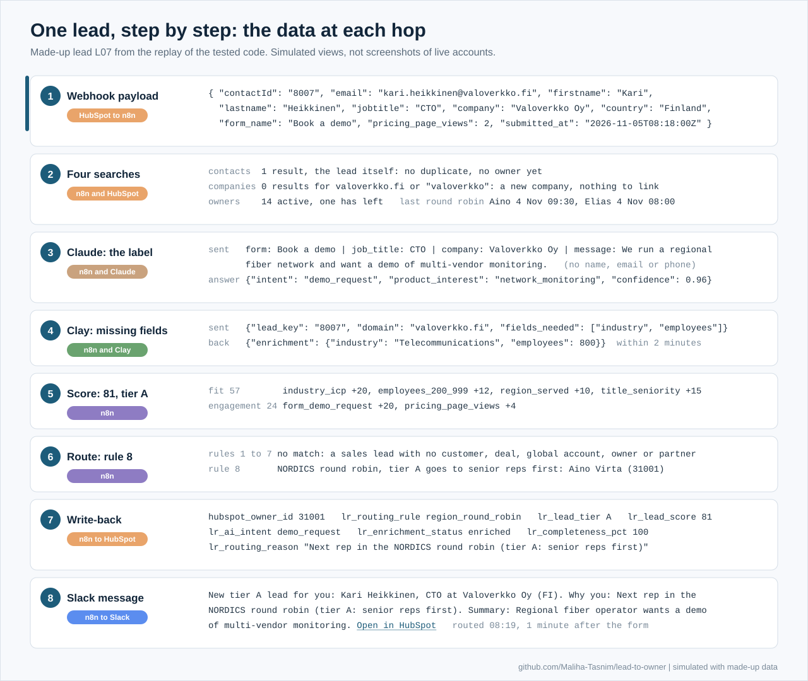

What it leaves behind in HubSpot and Slack:

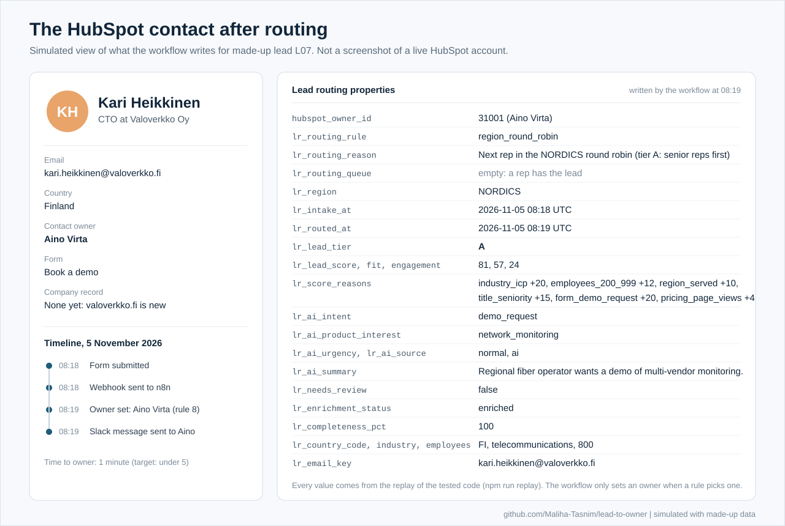

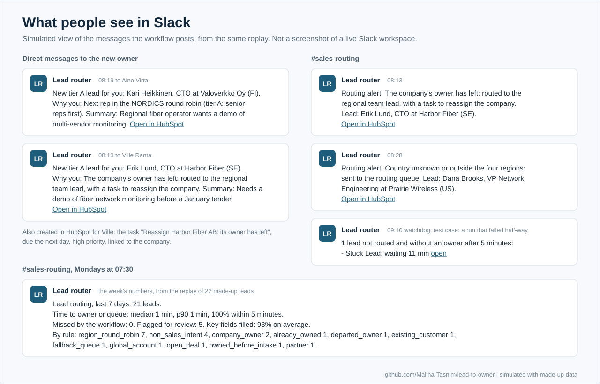

## A run in n8n

The same lead run through the imported workflow in n8n Cloud (version 2.45). HubSpot, Claude, Clay and Slack weren't connected, so the made-up answers the tests use are pinned on those nodes (purple). The Code nodes ran in n8n itself, and green shows the path the lead took.

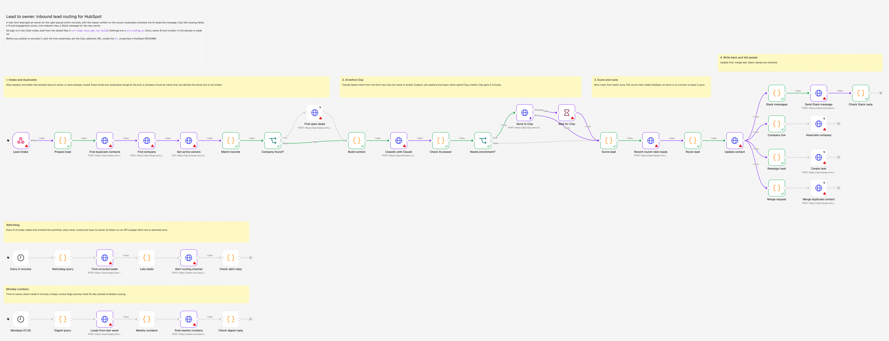

Claude's answer is checked before anything uses it. It's valid JSON, on the allowed lists and confident enough, and industry and company size are missing, so the lead goes to Clay:

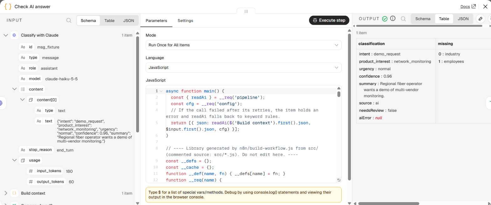

The routing decision, with the four recent round-robin leads it read from HubSpot: tier A, score 81, and Aino Virta as the next senior rep in the Nordics, with the reason written on the record:

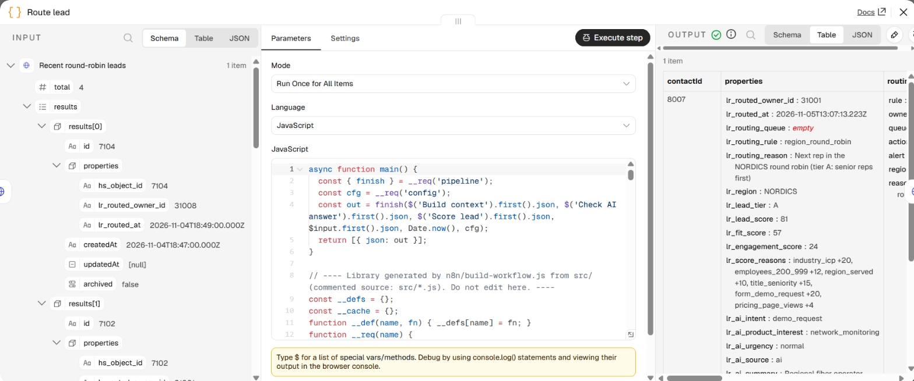

In this run the owner, the reason, the Slack message and every property written to HubSpot except the routing time are the same as the replay of the tested code for L07.

The watchdog and the Monday numbers, run the same way. Here the week's 22 made-up leads include one that never got an owner, so the Monday post counts one miss:

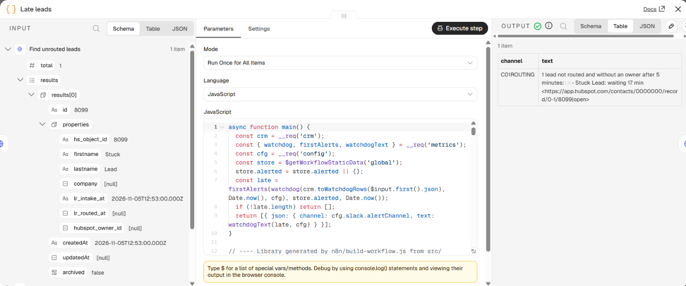

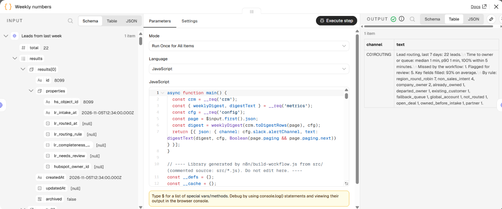

## The nine rules

| # | Rule | When | Goes to |
|---|------|------|---------|
| 1 | `non_sales_intent` | Throwaway email, or the AI says support, job seeker, vendor pitch or spam | Support desk, recruiting inbox or a "not a lead" queue that sales ops reviews weekly |
| 2 | `existing_customer` | The company is a customer with an active owner | The account owner |
| 3 | `open_deal` | The company has an open deal | The owner of the latest open deal |
| 4 | `global_account` | Any of the lead's or company's domains belongs to an account that spans two regions | Its named owner, whatever the lead's country |
| 5 | `company_owner` | The company already has an active owner | The same rep |
| 6 | `departed_owner` | The company's owner has left | The regional team lead, plus a task to reassign the company and an alert |
| 7 | `partner` | Partner or reseller enquiry | The partner manager |
| 8 | `region_round_robin` | Everything else in one of the four regions | The rep in that region whose last round-robin lead is oldest; tier A goes to senior reps first; reps on leave are skipped |
| 9 | `fallback_queue` | Country unknown or outside the regions, or nobody available | The routing queue, with an alert |

One guard sits before rules 2 to 9: a lead that turns out to be a known contact with an active owner keeps that owner (`already_owned`). Account rules come before the round robin, so a lead from a customer, a company with an open deal or a company that already has an owner goes to that person.

## Decisions that matter

- **The AI only labels.** Claude returns intent, product interest, urgency, a confidence and a one-line summary for the rep. The owner always comes from the rules. The answer is parsed strictly, checked against fixed lists, and ignored below 0.7 confidence, when keyword rules take over and the lead is flagged for review. If the API is down, the lead is still routed. The request uses low effort with thinking off and sends no temperature, which API version 2026-10-21 rejects.
- **Prompt injection.** Angle brackets in the form text are escaped, so it can't close or reopen the `<lead>` block, and the system prompt says to treat it as data. Links are removed from the model's summary, and everything from the form or the model is escaped before it goes into Slack. A test makes the model obey an injected instruction: the label changes, the owner doesn't.
- **Exact merges only.** HubSpot already refuses a second contact with the same email, so the duplicates that get through are variants (+tags, Gmail dots, googlemail.com). Those are merged on a normalized email key. A company found by name only can decide the owner, flagged for review, but isn't linked automatically.
- **No counter for the round robin.** The next lead goes to the rep whose last round-robin lead is oldest, read from HubSpot. Reps joining, leaving or coming back from leave need no special case.
- **Owners are left alone.** The workflow sets an owner only when a rule picked one, and a contact that already has one keeps it, including one taken by a person while the lead was in flight.
- **Clay only for missing fields.** Clay runs only for sales leads with a missing field, and the request lists only the missing fields. CRM values, which people curate, come first.
- **Every decision is visible.** Rule code, reason, score reasons, AI labels and source, enrichment status and a needs-review flag are written to the contact, so anyone can see why a lead went where it did and report on it.
- **Shadow mode first.** With `mode: 'shadow'` the workflow records the owner it would pick without assigning, merging or messaging reps (the watchdog and the Monday numbers still post to the routing channel), so its choices can be compared with manual assignment before go-live.

## Run it locally

Node 22 or newer, no packages to install.

```bash
npm test                # 95 tests
npm run replay          # the 22 made-up leads, one line each, then the Monday numbers
npm run replay:shadow   # the same in shadow mode
npm run build           # rebuild n8n/lead-to-owner.workflow.json from src/
```

All 22 leads, as `npm run replay` prints them:

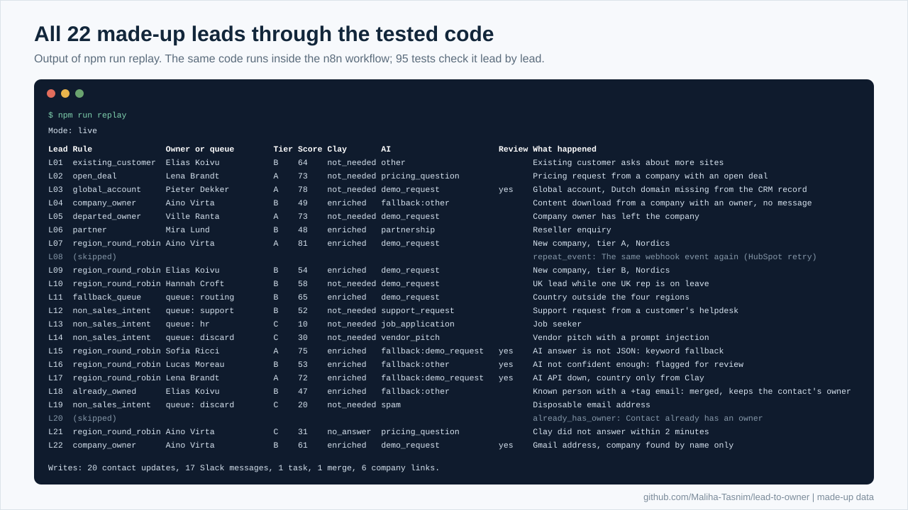

What the tests cover:

- Each module on its own: normalization, duplicates, scoring and tier boundaries, the AI request and answer checks, all nine rules and the guard, the HubSpot request bodies, the metrics, Slack escaping.
- 22 made-up leads (fixtures/leads.json) replayed in time order against an in-memory HubSpot that answers the real search bodies, with expected outcomes for each lead, in live and shadow mode.
- The built n8n file: its wiring, every `$('Node')` reference, every Code node, and a full run of every lead through a small n8n-style runner, compared with the tested code lead by lead. A failed Clay call, a Slack error reply, the watchdog and the Monday numbers run the same way.

## Set it up

**HubSpot**

1. Create the contact properties in the table below (group: Lead routing), with the dropdown values listed. HubSpot rejects the whole update if a dropdown value is missing.
2. Create a HubSpot token (service key or private app) with these scopes: `crm.objects.contacts.read`, `crm.objects.contacts.write`, `crm.objects.companies.read`, `crm.objects.companies.write`, `crm.objects.deals.read`, `crm.objects.owners.read`. HubSpot's task docs list `crm.objects.contacts.write` for creating tasks.
3. Build a contact workflow. Enrollment: a submission of your sales forms, and contact owner is unknown. Actions: set `lr_intake_at` to the time of the step, then send a webhook (POST) to the n8n production URL of the "Lead intake" node, with a secret header `X-Lead-Router-Key` and a custom body that uses the keys below.
4. Fill `lr_email_key` on existing contacts once, with a short script over the contacts API, so older records can be found as duplicates. New leads get it from the workflow.

**Clay.** A table with a webhook source. Enrichment columns for company industry, employee count, the person's country and job title, each set to run only when `fields_needed` lists its field (that is what saves the credits). An HTTP API column that POSTs to the row's `callback_url` with the header `X-Clay-Callback-Key` and the body `{"enrichment": {"country": ..., "industry": ..., "employees": ..., "job_title": ...}}`.

**Slack.** An app with the `chat:write` bot scope, invited to the routing channel. Direct messages go to members by their Slack member ID (`ownerSlackIds` in the config).

**Anthropic.** An API key, sent in the `x-api-key` header. The model is set in `src/config.js` (`claude-haiku-5-5`).

**n8n.** Import `n8n/lead-to-owner.workflow.json`. Pick the five credentials (a HubSpot token, which n8n 2 lists as HubSpot Service Key; header auth for Anthropic, Slack, the intake secret and the Clay callback secret) and paste your Clay webhook URL into "Send to Clay". Edit `src/config.js` (regions, reps, global accounts, thresholds, Slack IDs), run `npm run build` and import again. Start with `mode: 'shadow'`, compare its choices with manual assignment, then switch to `'live'`.

The node types are n8n 1.x versions (Code 2, HTTP Request 4.2, IF 2, Wait 1.1, Schedule Trigger 1.2). The HubSpot calls use API version 2026-09 and the Anthropic call uses 2026-10-21.

### Webhook payload

```json
{
  "contactId": "8007",
  "email": "kari.heikkinen@valoverkko.fi",
  "firstname": "Kari",
  "lastname": "Heikkinen",
  "jobtitle": "CTO",
  "company": "Valoverkko Oy",
  "website": "",
  "country": "Finland",
  "message": "We run a regional fiber network and want a demo of multi-vendor monitoring.",
  "form_id": "f-demo",
  "form_name": "Book a demo",
  "form_type": "demo_request",
  "submitted_at": "2026-11-05T08:18:00.000Z",
  "lr_intake_at": "2026-11-05T08:18:00.000Z",
  "pricing_page_views": 2,
  "webinar_attended": false,
  "email_clicks_30d": 0,
  "last_activity_at": "2026-11-05T08:18:00.000Z",
  "hubspot_owner_id": ""
}
```

### Properties it writes

| Property | Type | What it holds |
|----------|------|---------------|
| `lr_intake_at` | Date and time | Set by the HubSpot workflow when the lead enters. The watchdog and the timing start here |
| `lr_routed_at`, `lr_routed_owner_id` | Date and time, text | When the workflow decided, and the owner it chose (also in shadow mode) |
| `lr_routing_rule` | Dropdown | `non_sales_intent`, `existing_customer`, `open_deal`, `global_account`, `company_owner`, `departed_owner`, `partner`, `region_round_robin`, `fallback_queue`, `already_owned` |
| `lr_routing_reason` | Text | The plain-language reason |
| `lr_routing_queue` | Dropdown | `support`, `hr`, `discard`, `routing` (empty when a rep gets the lead) |
| `lr_region` | Dropdown | `NORDICS`, `DACH`, `UKI`, `REST_OF_EUROPE` in the sample config |
| `lr_lead_tier` | Dropdown | `A`, `B`, `C` |
| `lr_lead_score`, `lr_fit_score`, `lr_engagement_score` | Number | The scores |
| `lr_score_reasons` | Text | Every point with its reason, for example `industry_icp +20, form_demo_request +20` |
| `lr_ai_intent` | Dropdown | `demo_request`, `pricing_question`, `partnership`, `support_request`, `job_application`, `vendor_pitch`, `spam`, `other` |
| `lr_ai_product_interest` | Dropdown | `network_monitoring`, `iot_platform`, `digital_twin`, `analytics`, `other` |
| `lr_ai_urgency` | Dropdown | `high`, `normal`, `low` |
| `lr_ai_source` | Dropdown | `ai`, `keyword_fallback` |
| `lr_ai_summary` | Text | One line for the rep, links removed |
| `lr_needs_review` | Yes or no | The AI was unsure or failed, or the company was matched by name only |
| `lr_enrichment_status` | Dropdown | `enriched`, `no_answer`, `not_needed` |
| `lr_completeness_pct` | Number | Share of the key fields that are filled |
| `lr_country_code`, `lr_industry`, `lr_employees` | Text, text, number | Normalized values used for the score |
| `lr_email_key` | Text | The normalized email the duplicate check searches on |
| `lr_duplicate_of` | Text | Shadow mode only: the record this lead would be merged into |

`jobtitle` is filled from Clay only when the form had none, and `hubspot_owner_id` is set only in live mode, only when a rule picked an owner.

## Known limits

- HubSpot search results trail writes by a few seconds, so two leads that arrive seconds apart can go to the same rep. The rotation then carries on as normal; that rep is not skipped later to make up for it.
- HubSpot's search endpoints allow five requests a second per account, and each lead makes four searches. Every call retries up to three times, two seconds apart. For bigger bursts, cap parallel runs with n8n's production concurrency limit (`N8N_CONCURRENCY_PRODUCTION_LIMIT`).
- The repeat-event check keeps keys in n8n's workflow static data, which is best effort. A repeat that slips through stops at the record check, because the contact by then has an owner or a routing time.
- When Clay hasn't answered after 2 minutes, the lead is scored and routed without it.
- A merge can give the surviving record a new ID, so the workflow updates the record first and merges last.
- The owner list is read in one page of up to 500 owners.
- The Monday post reads one page of up to 200 leads and says so when there are more; the HubSpot reports hold the full numbers.

## Layout

```text
src/         the logic, one module per concern; config.js holds every setting
  pipeline.js  the six steps the n8n Code nodes call
  route.js     the nine rules        score.js     fit and engagement
  classify.js  AI request and checks  dedupe.js    repeats and duplicates
  enrich.js    Clay request and answer crm.js     HubSpot bodies and mappings
  metrics.js   timing, watchdog, completeness, Monday numbers
  normalize.js emails, domains, company names, countries, industries
n8n/         build-workflow.js and the importable workflow it builds
fixtures/    made-up CRM data and 22 made-up leads with expected outcomes
test/        node:test suites, an in-memory HubSpot and a small n8n-style runner
scripts/     replay.js
docs/        the flow diagram and the two-page design notes
  media/     the animation, the integration map and the screens (SVG, built from the replay),
             and screenshots of the n8n run (PNG)
```

## How I built it

I set the design and the rules from the routing I ran at BaseN, and wrote this version with an AI coding assistant, the way I work: the assistant drafts, and I review, test and run every change.

## About me

I'm Maliha Tasnim, an engineer who moved to the customer side: I get B2B customers live, keep them healthy, and build the CRM and automation behind it. [LinkedIn](https://www.linkedin.com/in/maliha-tasnim)

## License

MIT
